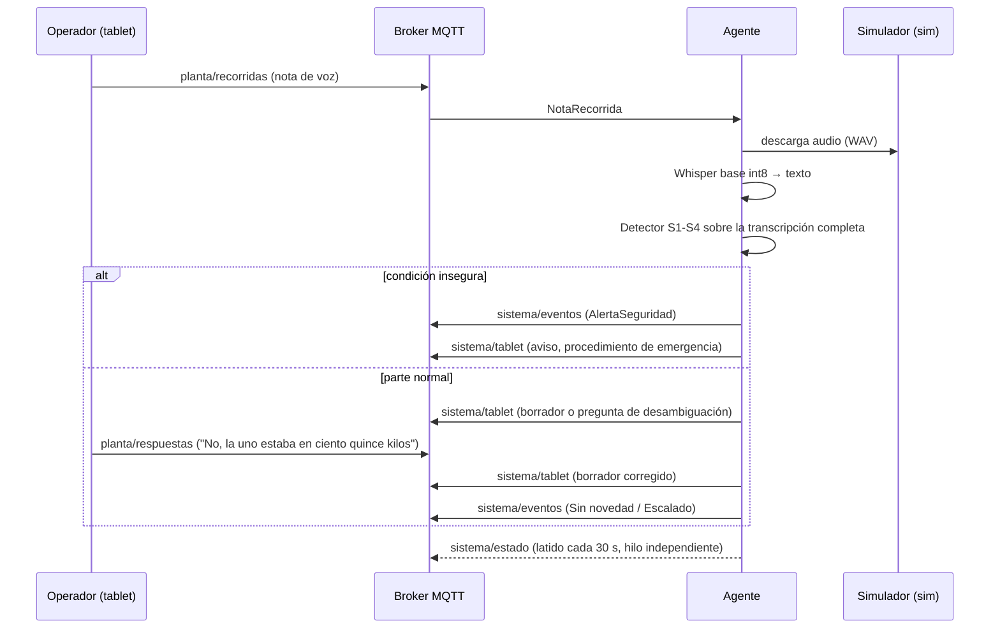
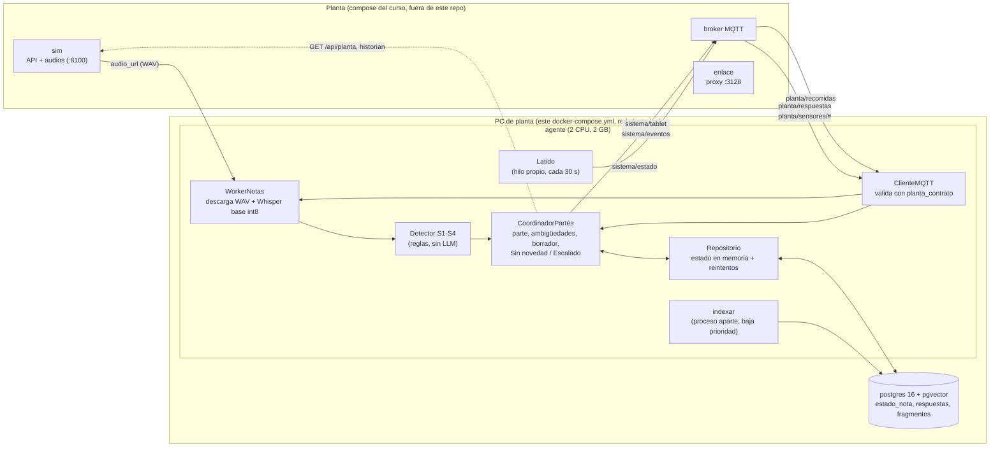

<div align="center">

# Agente de planta · Entrega 1

### *Parte de recorrida por voz y detección local de condiciones inseguras, sin LLM ni dependencia de servicios en la nube.*


**[Informe técnico](INFORME.md)** &nbsp;·&nbsp;
**[Decisiones](docs/DECISIONES.md)** &nbsp;·&nbsp;
**[Spec del parte](docs/SPEC_PARTE.md)** &nbsp;·&nbsp;
**[Memoria](docs/MEMORIA.md)**

Trabajo práctico de la Academia Novit 2026 · Desarrollo de Agentes IA y Software Agéntico

</div>

---

## Resumen

Un operador recorre una planta de inyección de agua, lee instrumentos que no están conectados al sistema de control y dicta notas de voz. Este sistema recibe esas notas, las transcribe **en la PC de la planta**, arma un parte con equipo, variable, valor y unidad, y le pide confirmación al operador por la tablet. Si la nota describe una condición insegura (agua a presión, olor a gas, humo o fuego, persona lesionada), publica la alerta en el momento, **sin enlace y sin modelos en la nube**.

Es la Entrega 1: parte por voz, detección, tools y MCP, y RAG medido. Las órdenes de trabajo, la aprobación y la certificación quedan para la Entrega 2 (ver [Límites](#límites)).

**Decisión central:** no hay ningún LLM en el camino crítico. La interpretación del parte y las decisiones de seguridad son reglas deterministas en código: con los mismos datos dan siempre el mismo resultado. El único modelo es Whisper, para transcribir.

---

## Problema

| Quién | Qué pasa hoy |
|-------|--------------|
| **Operador de planta** | Anota en papel y carga el parte al final del turno: llega tarde y con errores de tipeo |
| **Supervisor de turno** | El aviso de una condición insegura puede llegar tarde o incompleto |
| **Planta** | El enlace de datos se corta durante horas; lo crítico no puede depender de la nube |

Restricciones del entorno, según el enunciado: PC en la sala de control **sin GPU, 4 núcleos y 8 GB**, enlace intermitente y modelos de una lista cerrada.

---

## Flujo



El latido corre en un hilo aparte y nunca espera a la transcripción.

---

## Arquitectura



### Qué corre dónde

Todo corre en la PC de planta: transcripción local, detección, reglas y Postgres. **No hay componentes en la nube en esta entrega.** Motivo: sin GPU, 4 núcleos y 8 GB, el enlace se corta (el corrector lo corta a los 10 minutos en `fuga-sin-enlace`) y la alerta de seguridad tiene que funcionar sin enlace. Detalle en [`docs/DECISIONES.md`](docs/DECISIONES.md) (D1).

### Servicios de este compose

| Servicio | Rol | Recursos |
|----------|-----|----------|
| **agente** | Recibe mensajes MQTT, descarga audio, transcribe con Whisper `base` int8 (beam 5 + prompt de vocabulario), detecta S1-S4, publica `EventoSistema` y `MensajeTablet` | 2 CPU · 2 GB |
| **postgres** | Persiste el estado de cada nota y sus respuestas; guarda los fragmentos indexados para RAG | 0,5 CPU · 1 GB |

La planta (`broker`, `enlace`, `sim`, `visor`) viene del compose del curso `academia2026-tp`.

### Estructura del repositorio

```
.
├── README.md · INFORME.md · docker-compose.yml
├── agente/
│   ├── Dockerfile · requirements.txt
│   ├── datos/                 stock.yaml, tareas.yaml (catálogo y stock)
│   └── sistema/               código del agente (main, worker, coordinador,
│                              seguridad, parte, tools, mcp_server, rag, ...)
├── docs/                      DECISIONES, SPEC_PARTE, MEMORIA, LIMITES, CONTEXT_BUILDER
├── evaluacion/                verdad.py (offline) y retrieval_eval.py
└── tests/                     suite automatizada
```

---

## Qué hace

| Requisito | Cómo se resuelve |
|-----------|------------------|
| Notas de voz | Descarga el WAV y transcribe con `faster-whisper` `base` int8, `beam_size=5`, `cpu_threads=2`, localmente |
| Esquema fijo | Una fila por equipo y variable (`FilaParte`), con la hora de la nota y no la del reloj de la máquina |
| Nombres informales | "La dos", "la de reserva" se resuelven contra el listado de equipos; si queda ambiguo, **pregunta** |
| Unidades | "Kilos" son kg/cm²; manómetros en kg/cm² (B-101), psi (B-102) y bar (B-103) |
| Rango histórico | Un valor fuera del rango de 45 días pide confirmación antes de guardarse |
| Confirmación | El borrador va a la tablet; el operador corrige hablando y el sistema reenvía el borrador |
| Detección | Cada parte confirmado genera un evento `Sin novedad` o `Escalado`, con las reglas de la hoja de datos (no las de la Rev. C vencida) |
| Condición insegura | Detector S1-S4 local; publica `AlertaSeguridad` y el aviso a la tablet |
| Tools de solo lectura | Equipos, historial de sensores, historial de órdenes, stock, catálogo de tareas y búsqueda en manuales, con Pydantic estricto (`extra="forbid"`), timeouts y reintentos |
| MCP | Las tools se exponen en `mcp_server.py` (servidor aparte, no forma parte del compose) |
| Control | Condiciones de corte, presupuesto de pasos y timeout global por nota |
| Memoria | Estado de la conversación de cada nota en Postgres; política en [`docs/MEMORIA.md`](docs/MEMORIA.md) |

---

## Cómo levantarlo

Requisitos: Docker con Compose, Python 3.11+ y el repo del curso.

```bash
# 1. Planta del curso (broker, enlace, sim, visor)
git clone https://github.com/NovitSoftware/academia2026-tp
docker compose -p planta -f academia2026-tp/docker-compose.yml up -d broker enlace sim visor

# 2. Agente + Postgres (la planta tiene que estar arriba: planta-lan es una red externa)
docker compose -p alumno-novit up -d --build
```

Variables de entorno (opcionales, ver `.env.example`): `MQTT_HOST`, `POSTGRES_DSN`, `PREGUNTA_TIMEOUT_S`, `OMP_NUM_THREADS`, `HTTP_PROXY`, `HTTPS_PROXY`, `NO_PROXY`, `INDEXAR_PG_AL_ARRANCAR`.

### Cómo verificar el flujo

```bash
docker compose -p alumno-novit ps
docker compose -p alumno-novit logs agente --tail 30

# Estado de cada nota persistido en Postgres
docker compose -p alumno-novit exec postgres psql -U novit -d novit \
  -c "select nota_id, estado, intento from estado_nota;"

# Fragmentos indexados en pgvector
docker compose -p alumno-novit exec postgres psql -U novit -d novit \
  -c "select count(*), count(embedding) from fragmentos;"

# Datos dentro de la imagen
docker compose -p alumno-novit run --rm --no-deps agente ls /app/datos
```

Si el contenedor `broker` incluye `mosquitto_sub`, se puede mirar el tráfico:
`docker compose -p planta exec broker mosquitto_sub -t "sistema/#" -v`.

---

## Tests y evaluación

```bash
pip install -r agente/requirements.txt
python -m pytest tests -q            # 151 passed, 1 skipped (necesita POSTGRES_DSN)
python evaluacion/retrieval_eval.py  # recall@k del RAG (con la planta arriba)

# Evaluación oficial del curso
python <RUTA_AL_REPO_academia2026-tp>/correccion/corregir.py --repo . --alumno <nombre> \
  --escenarios martes-tranquilo fuga-sin-enlace --salida correccion/corridas/<nombre>
```

### Resultados del corrector

Corridas locales sobre `martes-tranquilo` y `fuga-sin-enlace` (63 de 93 puntos medidos, reescalados a 100). **La nota varió entre 84,1 y 86,7 según la corrida**: los escenarios no son idénticos entre corridas.

| Criterio | Última corrida |
|----------|---------------:|
| A1 Cobertura | 88 % |
| A2 Borrador al primer intento | 58 % |
| A3 Parte final correcto | 64 % |
| A4a Pregunta cuando hace falta | 100 % |
| A4b No pregunta de más | 100 % |
| B1 Sin novedad / Escalado | 92 % |
| B2 Alerta de seguridad | 100 % |
| E1 Sigue andando sin enlace | 100 % |
| E2 Pendientes visibles | 50 % |
| E3 Sin duplicados | 100 % |
| F1 Mensajes válidos | 100 % |
| F2 Latido | 100 % |

### Latencia de transcripción

Medida en una notebook con Intel Core i3-1115G4 (2 núcleos), modelo caliente, int8, 2 hilos, nota de 11,24 s: Whisper `base` con beam 1 tarda 4,46 s y con beam 5 tarda 5,41 s. `small` tarda 19,77 s con beam 1 y 24,38 s con beam 5, y por eso se descartó. Más datos en [`INFORME.md`](INFORME.md).

### Recuperación (RAG)

Búsqueda sobre 701 fragmentos de los manuales de la planta, medida con las 71 preguntas de `retrieval.json`:

| Métrica | Este sistema | Línea base BM25 |
|---------|-------------:|----------------:|
| hit@5 | 0,831 | 0,850 |
| recall@5 | 0,702 | 0,660 |
| Rev. C antes que D | 0/71 | n/d |

hit@5 queda levemente por debajo de la base y recall@5 por encima. El 0/71 de la Rev. C se debe a que la búsqueda filtra por `vigente` y deja afuera el manual vencido; no es una preferencia aprendida.

La búsqueda combina BM25 con embeddings hash deterministas (`zlib.crc32` sobre 4096 posiciones con pesos IDF), fusionados con RRF. Los fragmentos se indexan en pgvector con un proceso aparte (`python -m sistema.indexar`) de baja prioridad. Eso fue necesario: con un hilo dentro del agente, el corrector bajó a 81,4 por competir con la transcripción y el latido. El embedding hash es una decisión propia, porque la lista cerrada de modelos no incluye uno de embeddings.

---

## Límites

Lo que **no** está implementado o no cumple, dicho de forma directa:

- **RAG fuera del flujo del agente.** `rag.py` y `manuales_buscar` funcionan y se miden offline, pero el agente no los usa todavía en su flujo. El análisis de anomalías llega en la Entrega 2.
- **Secciones que no aplican.** `manuales_buscar` excluye la Rev. C, el historial y los contratos por metadatos, y algunas secciones dedicadas a otros modelos (`TX350-D §3.3`, `MBP-4 §17.x`) por id. Las secciones mixtas se devuelven completas porque no se pueden separar sin filtrar por texto.
- **E2 en 50 %.** El latido publica `enlace_ok` fijo en `True`. El agente no detecta el corte de enlace ni cuenta pendientes durante él.
- **A2 y A3.** El primer borrador solo se confirma sin correcciones en el 58 % de los casos; es el criterio con más margen de mejora.
- **Sin órdenes de trabajo.** No hay borrador de orden, reglas de aprobación, cierre por voz ni certificación (Entrega 2).
- **Servidor MCP aparte.** `mcp_server.py` se ejecuta por separado y no forma parte del compose.
- **Sin `/api/verdad` en ejecución.** El agente no la lee; solo la usa `evaluacion/verdad.py`, offline.
- **Sin LangChain.** Esta entrega no usa LLM, así que no hay núcleo de agentes con LangChain.

---

## Roadmap

Planificado, **no implementado**:

**Proxima entrega**
- Análisis de anomalías con manuales y historial, citando la sección de cada conclusión
- Borrador de orden de trabajo y reglas de aprobación en código
- Detección real del corte de enlace y cola de pendientes de sincronización
- Cierre por voz y certificación de la contratista

---

## Stack

Python 3.11 · faster-whisper 1.2.1 · paho-mqtt · PostgreSQL 16 + pgvector · Pydantic · `planta_contrato` · MCP (`mcp<2`) · Docker Compose

---

<div align="center">

## Autoría

Desarrollado por **Beverly Gonzalez Casanova** ([@licette32](https://github.com/licette32)).

**Academia Novit 2026 · Desarrollo de Agentes IA y Software Agéntico**

</div>