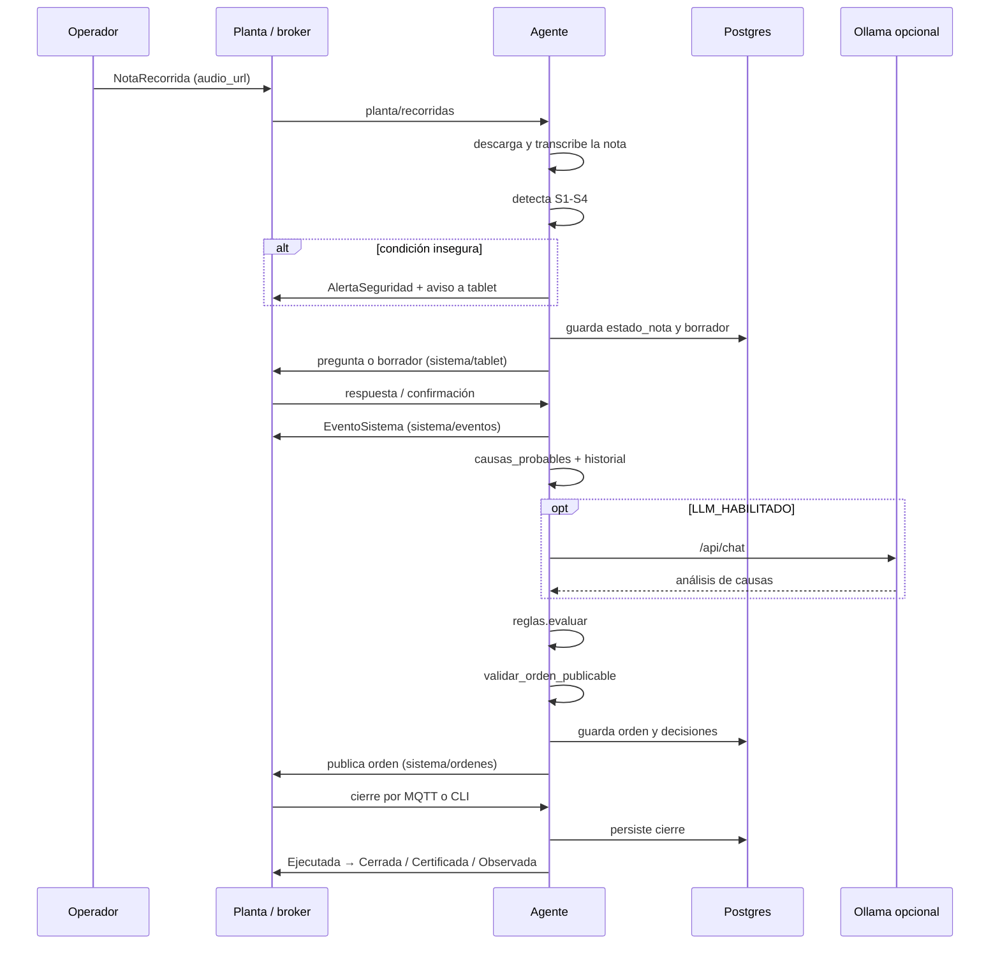
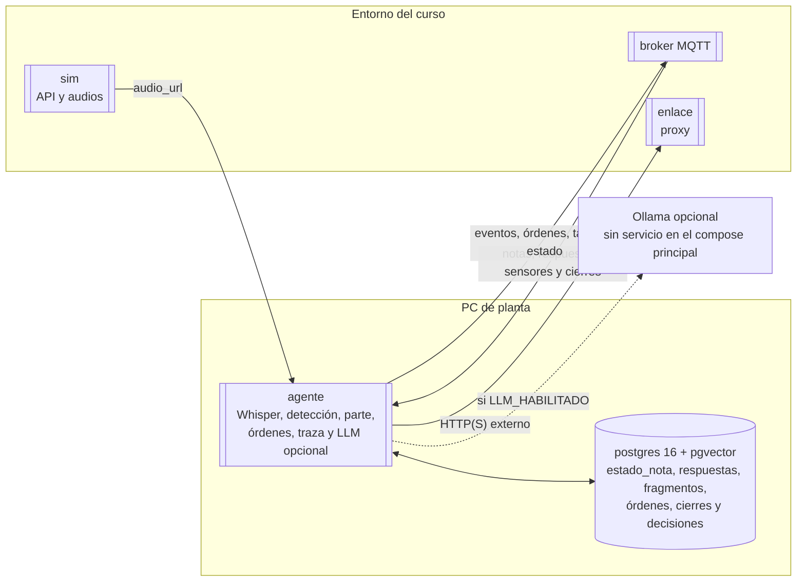

<div align="center">

# Agente de planta · Entrega 2


[Informe](INFORME.md) &nbsp;·&nbsp; [Decisiones](docs/DECISIONES.md) &nbsp;·&nbsp; [Spec del parte](docs/SPEC_PARTE.md) &nbsp;·&nbsp; [Memoria](docs/MEMORIA.md) &nbsp;·&nbsp; [Límites](docs/LIMITES.md)

Trabajo práctico de la Academia Novit 2026 · Desarrollo de Agentes IA y Software Agéntico

</div>

---

## Resumen

El agente recibe notas de voz del recorrido, las transcribe en la PC de la planta, detecta condiciones inseguras (S1-S4) y arma el parte con confirmación del operador. A partir de los eventos genera causas y órdenes de trabajo con reglas y revisor, con análisis LLM opcional, y registra cierre y certificación.

---

## Problema

| Quién | Qué pasa hoy |
|-------|--------------|
| **Operador de planta** | Toma nota en papel de instrumentos que no están conectados al sistema de control y carga el parte al final del turno |
| **Supervisor de turno** | Puede recibir tarde o incompleto el aviso de una condición insegura y la orden de trabajo |
| **Planta** | El enlace de datos se corta durante horas |

Restricciones del entorno: PC de la sala de control con **4 CPU, 8 GB y sin GPU**, enlace intermitente y lista cerrada de modelos.

---

## Flujo



---

## Arquitectura



### Qué corre dónde

Todo en la PC de la planta; LLM opcional local; sin nube. Detalle en [D1](docs/DECISIONES.md#d1-ejecución-local).

### Servicios del compose

| Servicio | Rol | Recursos |
|----------|-----|----------|
| **agente** | MQTT, audio, Whisper, detección, parte, órdenes, cierres, traza y LLM opcional | 2 CPU · 2 GB |
| **postgres** | Estado de notas, respuestas, fragmentos, órdenes, cierres y decisiones | 0,5 CPU · 1 GB |

Ollama no está en el compose principal; si se habilita, el agente lo alcanza como servicio local opcional.

### Estructura del repositorio

```
.
├── README.md · INFORME.md · docker-compose.yml · .env.example
├── agente/
│   ├── Dockerfile · requirements.txt
│   ├── datos/                  materiales.yaml
│   └── sistema/                main.py, worker.py, coordinador.py, seguridad.py,
│                               flujo.py, reglas.py, validacion.py, llm.py,
│                               control_flujo.py, repositorio_decisiones.py, ...
├── docs/                      DECISIONES.md · SPEC_PARTE.md · MEMORIA.md · LIMITES.md
├── evaluacion/                 verdad.py · retrieval_eval.py
└── tests/                      suite automatizada
```

Las decisiones se guardan en la tabla `decisiones` de Postgres.

---

## Qué hace

| Requisito | Cómo se resuelve |
|-----------|------------------|
| Parte por voz | Descarga el WAV, transcribe con `faster-whisper`, arma filas por equipo y variable y pregunta cuando hay ambigüedad |
| Detección | Reglas S1-S4 sobre la transcripción completa; publica `AlertaSeguridad` y avisa a la tablet |
| Órdenes con reglas | Genera causas, consulta historial y aplica `reglas.evaluar` antes de publicar |
| Revisor de citas y repuestos | `validar_orden_publicable` revisa citas y repuestos antes de publicar la orden |
| LLM opcional | Análisis de causas detrás del flujo; apagado por defecto |
| Durabilidad ante corte | Reanuda notas y órdenes pendientes y conserva el estado en Postgres |
| Cierre y certificación | Cierres por MQTT/CLI; estados `Ejecutada`, `Cerrada`, `Certificada` y `Observada` |
| CLI | `aprobar`, `rechazar`, `cerrar`, `certificar`, `observar` y consulta de cierres |
| Reintentos, deadline y loops | Reintentos de lectura, deadline y detección de loops en el flujo de órdenes |
| Trazabilidad de cada paso | Cada paso se registra en `decisiones` con `correlation_id` |

---

## Cómo levantarlo

Requisitos: Docker con Compose, Python 3.11+ y el repositorio del curso.

```bash
# 1. Planta del curso (broker, enlace, sim, visor)
git clone https://github.com/NovitSoftware/academia2026-tp
docker compose -p planta -f academia2026-tp/docker-compose.yml up -d broker enlace sim visor

# 2. Agente + Postgres
docker compose -p alumno-novit up -d --build
```

Variables de entorno (opcionales, ver `.env.example`): `MQTT_HOST`, `MQTT_PORT`, `SISTEMA_NOMBRE`, `HEARTBEAT_S`, `LOG_LEVEL`, `TZ`, `HTTP_PROXY`, `HTTPS_PROXY`, `NO_PROXY`, `POSTGRES_DSN`, `POSTGRES_USER`, `POSTGRES_PASSWORD`, `POSTGRES_DB`, `POSTGRES_REINTENTO_S`, `PREGUNTA_TIMEOUT_S`, `OMP_NUM_THREADS`, `INDEXAR_PG_AL_ARRANCAR`, `FLUJO_LIMITE_S`, `REINTENTOS_TOOL_LECTURA`, `ESPERA_REINTENTO_TOOL_S`, `UMBRAL_LOOP_PASOS`, `LLM_HABILITADO`, `LLM_BASE_URL`, `LLM_API_KEY`, `LLM_MODELO`, `LLM_TIMEOUT_S`, `LLM_COSTO_USD_POR_MTOK_ENTRADA` y `LLM_COSTO_USD_POR_MTOK_SALIDA`.

El LLM viene apagado; si se habilita usa Ollama en `/api/chat` y el host local debe estar en `NO_PROXY`. Detalle en [D8](docs/DECISIONES.md#d8-ollama-y-red).

### Cómo verificar el flujo

```bash
docker compose -p alumno-novit ps
docker compose -p alumno-novit logs agente --tail 30

docker compose -p alumno-novit exec postgres psql -U novit -d novit \
  -c "select nota_id, estado, intento from estado_nota order by actualizado_ts desc limit 20;"

docker compose -p alumno-novit exec postgres psql -U novit -d novit \
  -c "select nota_id, ts, payload from respuestas order by ts desc limit 20;"

docker compose -p alumno-novit exec postgres psql -U novit -d novit \
  -c "select id, doc, numero, titulo, vigente from fragmentos limit 10;"

docker compose -p alumno-novit exec postgres psql -U novit -d novit \
  -c "select correlation_id, paso, modelo, herramienta, tokens, costo_usd, duracion_ms from decisiones order by creado_ts desc limit 20;"

docker compose -p alumno-novit exec postgres psql -U novit -d novit \
  -c "select id, estado, correlation_id from ordenes order by actualizado_ts desc limit 20;"

docker compose -p planta exec broker mosquitto_sub -t "sistema/#" -v
```

---

## Tests

```bash
python -m pytest tests -q
```

Los resultados se registran en [INFORME.md](INFORME.md).

---

## Stack

Python 3.11 · faster-whisper · paho-mqtt · PostgreSQL 16 + pgvector · Pydantic · `planta_contrato` · MCP · `control_flujo.py` · Ollama opcional · Docker Compose

---

<div align="center">

## Autoría

Desarrollado por **Beverly Gonzalez Casanova** ([@licette32](https://github.com/licette32)).

**Academia Novit 2026 · Desarrollo de Agentes IA y Software Agéntico**

</div>
